# STM32F103定时器——从周期闪烁LED到PWM呼吸灯实践

[toc]

## 0 前言

该博客基于STM32F103C8T6配置定时器外设，利用定时器计数实现2sLED周期亮灭以及配置PWM输出，实现呼吸灯效果，同时借助Keil虚拟示波观察PWM波形，理解PWM占空比调节原理。

## 1 初识STM32定时器

定时器，简单来说属于芯片计数器外设，它可以接收时钟脉冲个数来计数，此过程不通过CPU。STM32F103共有8个定时器TIM1~TIM8，TIM2-TIM5属于通用定时器，本次实验重要讲解。

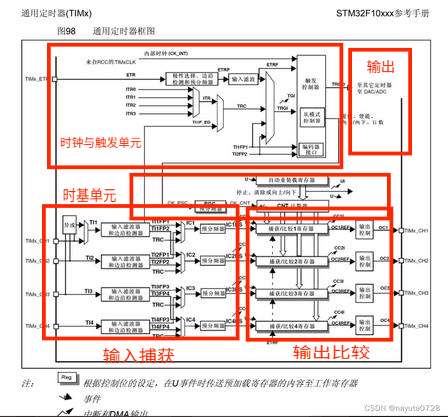

其内部框图主要划分为四大模块：时钟与触发单元、时基单元、4路捕获比较通道、事件输出单元。

### 1.1时钟与触发单元

提供定时器计数时钟源，有内部时钟CK_INT、外部触发、定时器互联触发。可选择不同时钟源驱动计数器。

### 1.2时基单元

包含预分频器PSC、16 位计数器、自动重载寄存器，用于产生计数时序。

:large_blue_diamond:预分频器PSC输入定时器时钟 f，经过 PSC 分频后供给计数器。

分频公式：
$$
f_{CNT}=\frac{f_{TIMCLK}}{PSC+1}
$$
:large_blue_diamond:计数器CNT有向上向下和中心对齐模式的计数器，本实验使用向上计数模式。CNT从0开始持续累加，直到CNT==ARR，产生更新事件，计数器溢出事件，可以触发中断，CNT 清零，重新从0开始计数，循环往复。

:large_blue_diamond:自动重载寄存器ARR存储计数器的计数上限，决定一次完整计数循环的总计数次数。

计数器一个循环的总时间也是PWM载波周期：
$$
T_{PWM}=\frac{ARR+1}{f_{CNT}}
$$
如我设置ARR=999，计数频率 1MHz：
$$
T_{PWM}=\frac{999+1}{1\times10^6}=1\mathrm{ms}
$$

### 1.3 4 路捕获比较通道

可独立配置为输入捕获或者输出比较PWM模式。本实验我使用CH1做PWM输出。它包含捕获比较寄存器、捕获比较逻辑、输出控制逻辑。

### 1.4事件输出

更新事件、比较匹配、捕获事件可以产生中断请求或者DMA请求，通知CPU处理。

:large_blue_diamond:利用输出比较模块硬件电路，通用定时器在本实验配置为中断回调与PWM脉冲宽度调制模式。

## 2 PWM脉冲调制基础

PWM输出周期固定、高电平宽度可调的数字脉冲，等效出连续变化的模拟电压用来控制LED灯亮度。

:red_circle:其中PWM最重要的概念为占空比，它是一个周期里面，高电平持续时间的比例。修改CCR寄存器，就能直接改变占空比，以此调节 LED 亮度，下文讲解如何得出占空比。

:large_blue_diamond:向上计数计数器不断递增，和CCRx做对比，CNT到ARR就清零循环，形成一个脉冲。

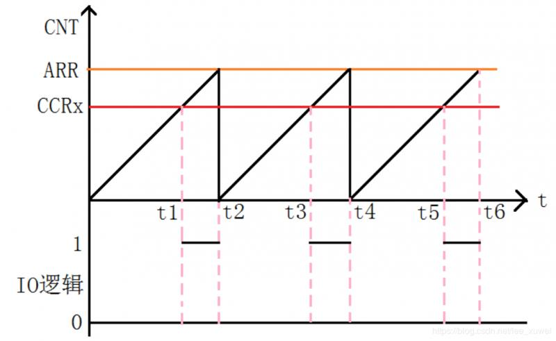

:large_blue_diamond:而定时器输入捕获测量外部脉冲主要有测频法测周法。测频法固定一段时间统计这段时间里脉冲上升沿数量，适合高频信号测周法测量单个脉冲完整周期，用定时器计数值换算频率，适合低频信号。

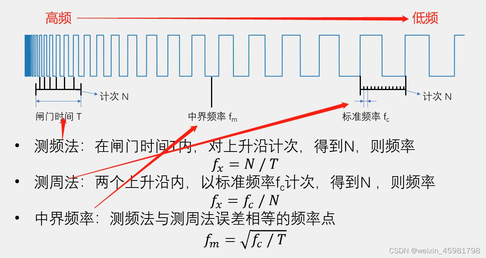

:large_blue_diamond:PWMI是定时器专门用来测量PWM信号的输入模式，基于测周法，用一个引脚，两个捕获通道配合，一次性测出信号周期和占空比。

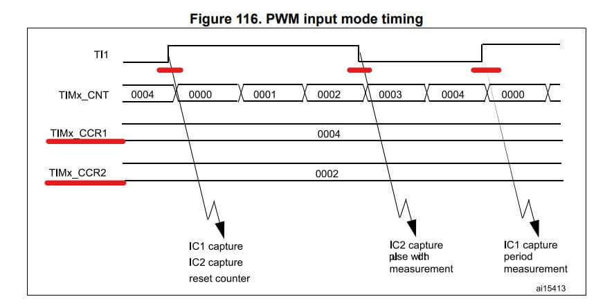

## 3 定时器计数实现LED2s周期亮灭

:large_blue_diamond:选择STM32F103芯片，配置好RCC与SYS基础配置后，再配置系统时钟，选择择HSE外部高速晶振与PLL 倍频配置，最终系统时钟输出 72MHz。

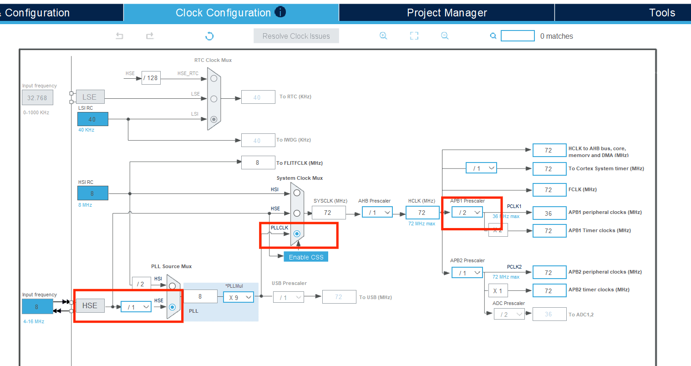

:large_blue_diamond:找到TIM2外设，时钟源选择内部时钟 

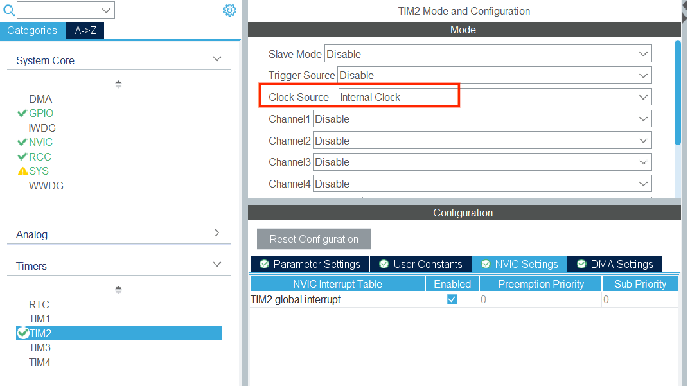

:large_blue_diamond:设置 TIM2 参数，PSC预分频设置为999，ARR设置为19999，配置定时器定时时间为2s.

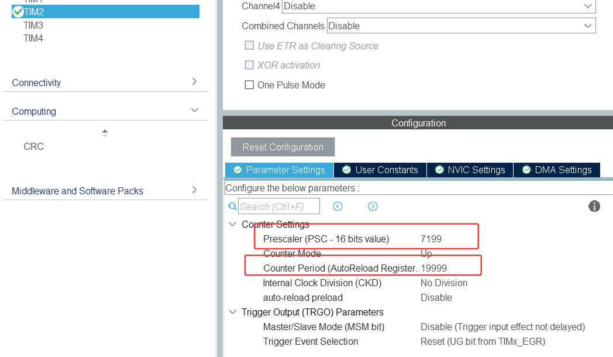

:large_blue_diamond:开启TIM2更新中断

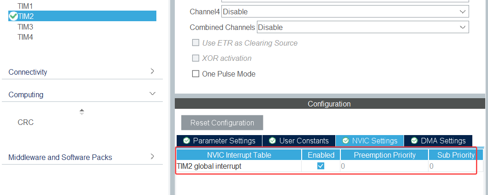

:large_blue_diamond:配置PA0引脚模式选为GPIO_Output，输出类型设置为推挽输出 

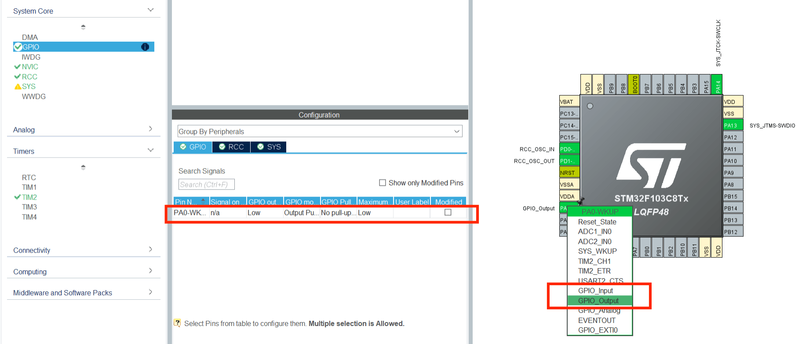

:large_blue_diamond:最后生成工程代码

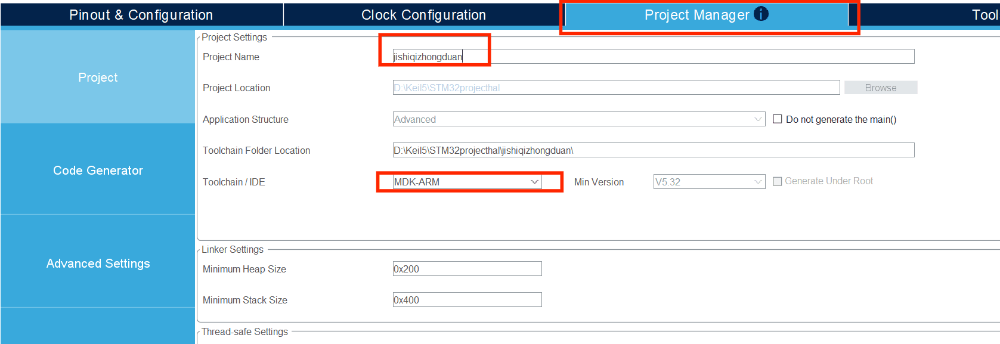

:large_blue_diamond:在生成的main.c代码中进行修改

再/* USER CODE BEGIN PV */添加如下代码

```c
uint8_t led_state = 0;  //LED状态变量，0=熄灭，1=点亮
```

定义全局变量led_state用来保存 LED 的亮灭状态，初始状态为熄灭。TIM2配置为每2s计数溢出并触发更新中断，一旦产生中断，就进入定时器溢出回调函数。

再/* USER CODE BEGIN 4 */添加如下代码

```c
void HAL_TIM_PeriodElapsedCallback(TIM_HandleTypeDef *htim)
{
	if(htim->Instance == TIM2)
	{
		led_state = !led_state;   //状态翻转：0变1，1变0
		//根据led_state，设置PA0引脚电平
		HAL_GPIO_WritePin(GPIOA, GPIO_PIN_0, led_state ? GPIO_PIN_SET : GPIO_PIN_RESET);
	}
}
```

进入回调函数后，首先翻转led_state的状态，再依据该变量设置PA0引脚输出高低电平。每间隔2秒切换一次LED状态，实现LED点亮2秒、熄灭2秒。

:large_blue_diamond:周期闪烁led实验现象如下：

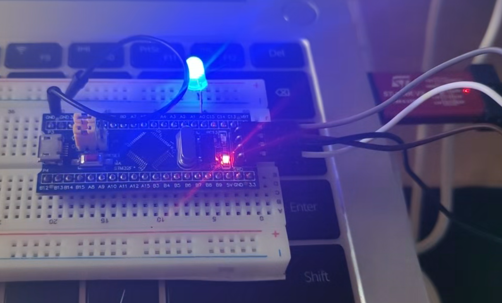

## 4 定时器PWM实现LED呼吸灯及波形观测

:large_blue_diamond:在任务一闪烁led配置基础上，我们取消TIM2中断

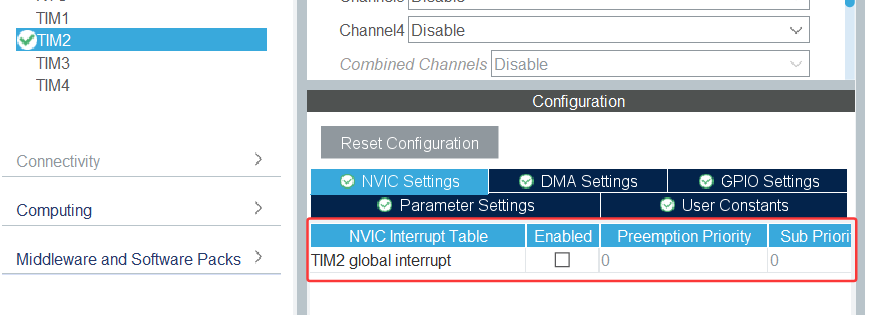

:large_blue_diamond:添加TIM2配置，将Channel1设置为PWM Generation CH1，配置完成后PA0引脚会自动复用为 TIM2_CH1功能引脚。

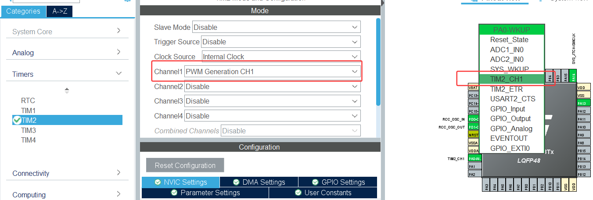

:large_blue_diamond:设置 TIM2 参数：PSC为71，ARR为999，所以PWM载波频率=
$$
72M/(71+1)/(999+1)=1\mathrm{kHz}
$$
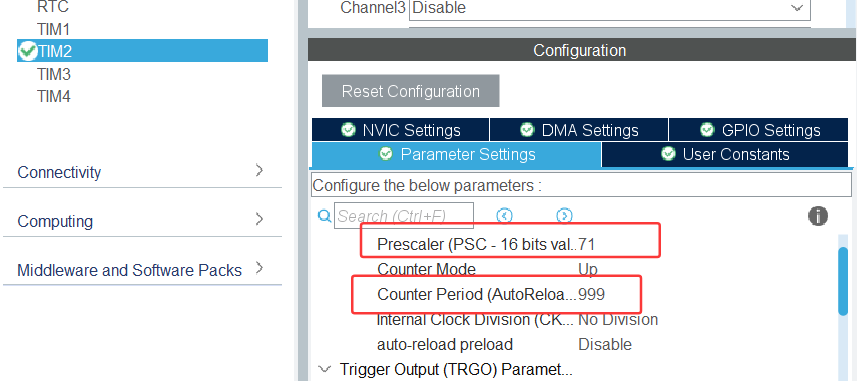

:large_blue_diamond:最后生成工程文件。

:large_blue_diamond:在生成的main.c代码中进行修改

因为ARR为999，我想设置周期为1s的呼吸灯，所以我最大宏为499，得出占空比50%。在*/* USER CODE END PV */加主循环。

```c
  while (1)
  {
    /* USER CODE END WHILE */

    /* USER CODE BEGIN 3 */
    if(dir == 1)
    {
        pwm_val++;
        if(pwm_val >= MAX_PWM)
        {
            dir = 0; //达到最大亮度，切换变暗
        }
    }
    else
    {
        pwm_val--;
        if(pwm_val == 0)
        {
            dir = 1; //达到最小亮度，切换变亮
        }
    }
    __HAL_TIM_SET_COMPARE(&htim2, TIM_CHANNEL_1, pwm_val); //更新PWM占空比
    HAL_Delay(0);  //间隔1ms，一轮完整呼吸约 998ms ≈ 1s
  }
```

若想更改周期为2s的，这里将两种方法，第一种可以更改占空比为100%，定义宏为#define MAX_PWM 999，第二种可以增加延时HAL_Delay(1)由1s延时到2s，总的来说，可以更改PWM占空比来改变呼吸灯周期，也是比较常用的方法。

:large_blue_diamond:我设置的是1s为周期的呼吸灯，实验现象如下：

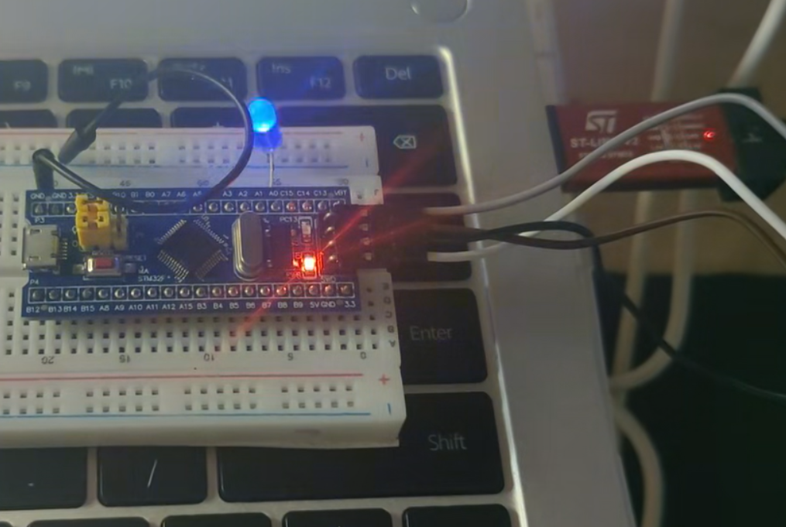

## 5 观察PWM输出波形

:large_blue_diamond:调整Debug为仿真设置

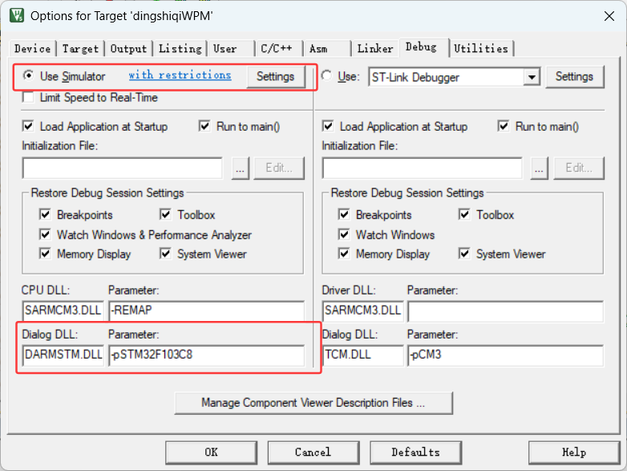

:large_blue_diamond:将PA0引脚接入Keil虚拟示波器

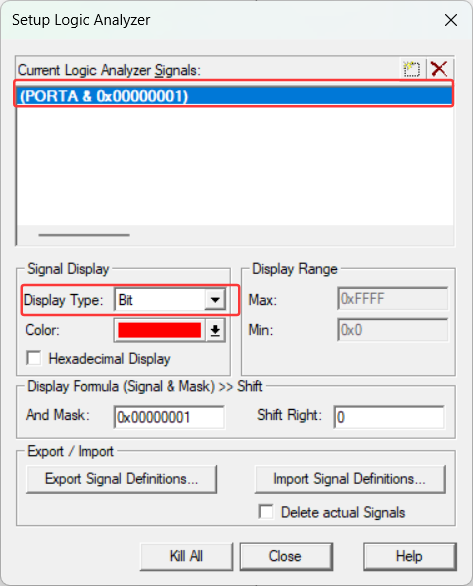

:large_blue_diamond:可以观测到周期为1s的波形如下：

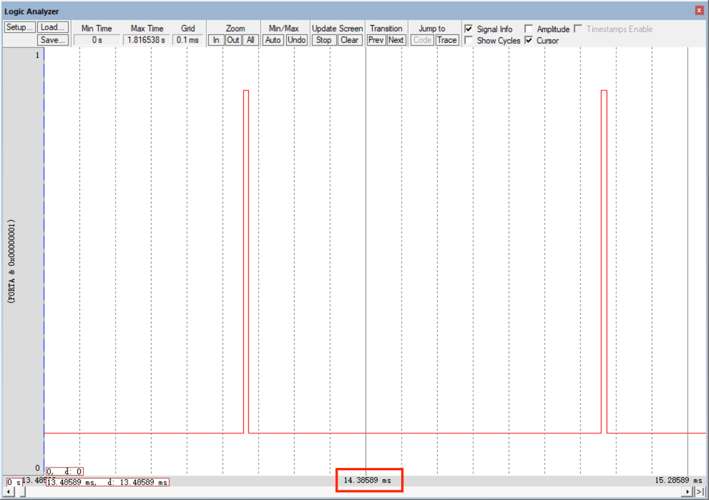

起始波形由窄变宽，led由暗到亮

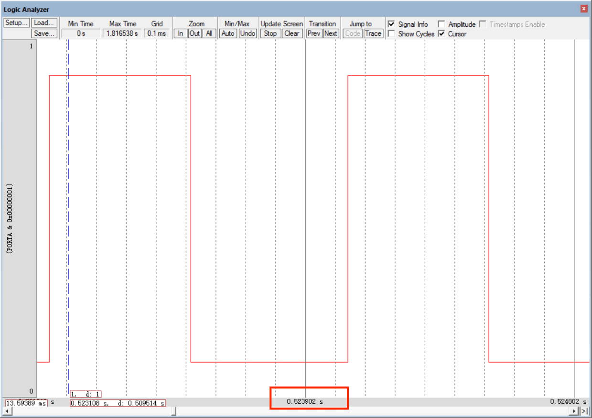

在0.5s左右达到峰值

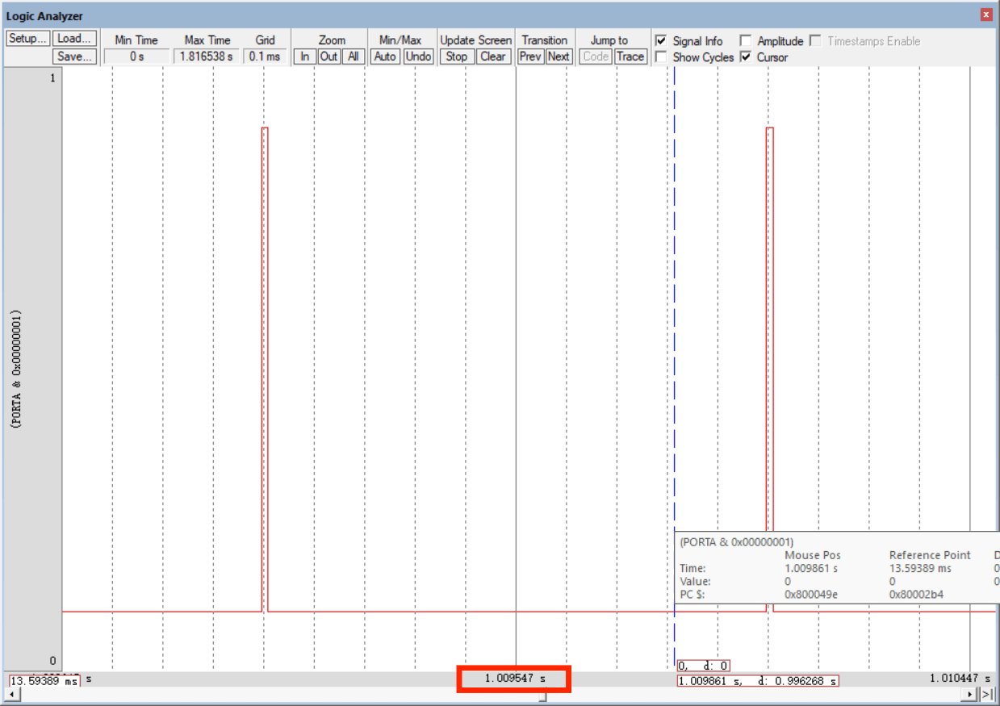

0.5-1s由亮到暗，验证了周期为1s的呼吸灯实验。

## 6 总结

本次实验主要掌握了STM32通用定时器两种用法：时基定时中断仅用计数器完成定时，用于固定周期电平翻转，理解了定时器计数溢出与中断回调的过程。

PWM模式则依靠CNT与CCR寄存器比较，输出可调节的占空比方波，映射到实物上为LED亮度的渐变，并借助波形加深占空比的理解。验证了PWM实现数字信号等效模拟调光的原理。